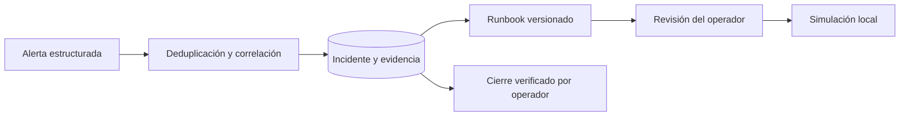

# Arquitectura

La clave de correlación combina tenant, servicio, entorno y señal. Cada alerta de origen tiene además una clave única que permite distinguir reentrega y observación nueva. Una alerta repetida con otro contenido se rechaza.

Los runbooks son datos versionados en `app/resources/runbooks.json` y se distribuyen como recurso del paquete. La aplicación recupera la guía correspondiente a una señal estructurada y devuelve citas. No realiza una búsqueda semántica ni infiere una causa raíz confirmada.

Ollama puede resumir el diagnóstico mediante un contrato de salida. Su respuesta se presenta como sugerencia independiente. No se usa para aprobar operaciones ni construir llamadas ejecutables.

La simulación utiliza una lista fija de nombres permitidos. Devuelve un resultado local sin acciones externas. Un ejecutor real necesitaría permisos por usuario, validación de alcance, idempotencia del destino, verificación posterior y reversión.
