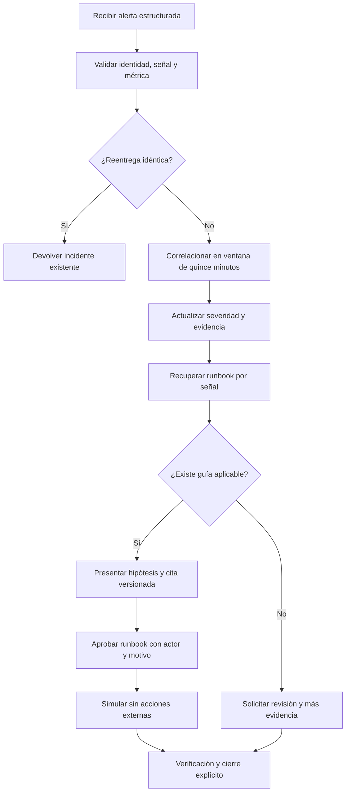

# Flujo de operación

[Abrir SVG](diagrams/flow.svg) · [Fuente Mermaid](diagrams/flow.mmd)

Versión Mermaid

- Una identidad de alerta reutilizada con otra carga se rechaza; una observación nueva puede agregarse al incidente abierto.
- Los runbooks se recuperan por señal estructurada. La causa permanece sin confirmar y una señal desconocida no habilita simulación.
- `simulate` registra `external_actions: 0`; no resuelve el incidente ni ejecuta comandos o reinicios.

Las operaciones del dominio se guardan junto a auditoría y respuesta idempotente en la transacción del servicio local. Un error revierte los cambios de esa solicitud.

[Arquitectura](architecture.md) · [Tecnologías y alcance](technologies.md)
